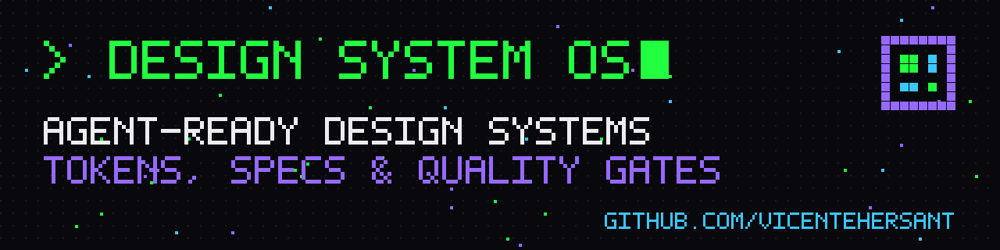
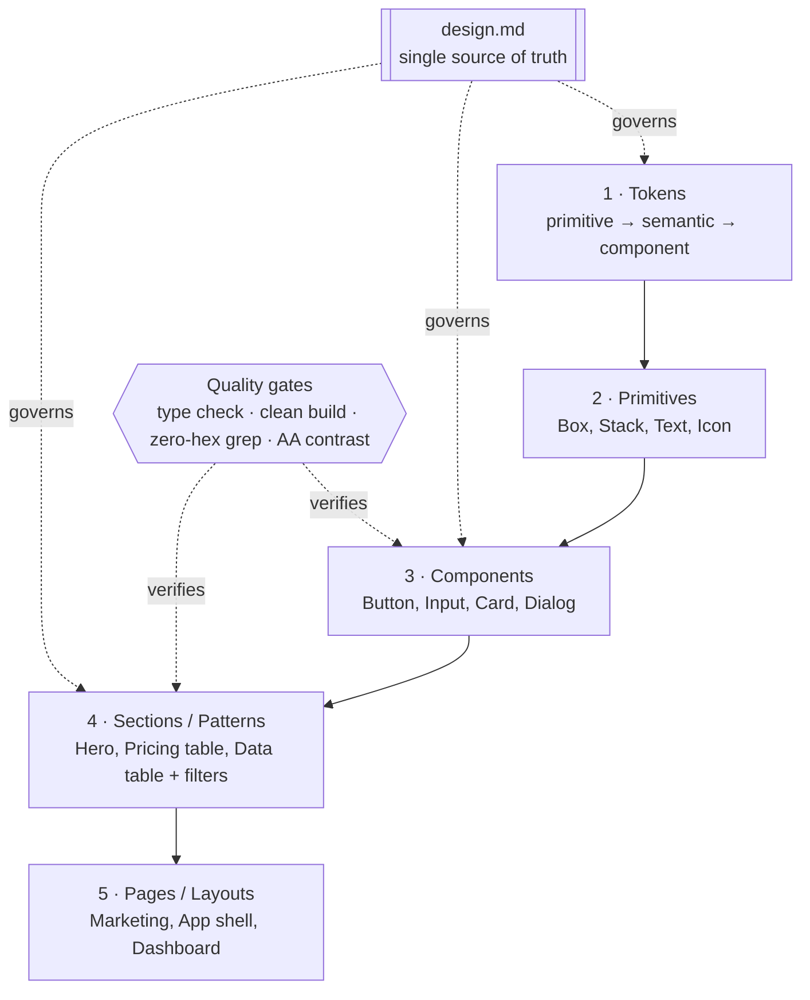

# Design System OS

**A method for building an advanced, agent-ready design system — one that humans can design with and AI coding agents can build from without drifting.**

Tokens → primitives → components → sections → pages. One `design.md` as the single source of truth. Specs precise enough that an agent can implement them, and quality gates strict enough that drift gets caught before it ships.

---

## Who it's for

- **Designers who code** and want their Figma decisions to survive contact with the codebase.
- **Small teams and solo builders** shipping several products who need one repeatable way to start a system.
- **Anyone working with AI coding agents** (Claude Code, Cursor, Copilot…) who is tired of agents inventing hex values, one-off spacing and components that already exist.

## The 5-layer model

Each layer may only consume the layer below it. A section never reaches for a raw color; a component never hardcodes a pixel value that a token already names.

## Quickstart — build your DS in a weekend

**Saturday morning — foundations**
1. Copy [`templates/design.md`](templates/design.md) into your project root. Fill in principles, brand, and voice.
2. Copy [`templates/tokens.css`](templates/tokens.css). Replace primitive palettes with your brand ramps; keep the semantic names.
3. For every brand accent, check text contrast. If it fails 4.5:1 on your background, add a `-text` token ([docs/02-tokens.md](docs/02-tokens.md#the--text-pattern)).

**Saturday afternoon — primitives**
4. Build layout + type primitives (Stack, Text, Container) that only accept token values.
5. Mirror tokens as Figma variables with the *same names* ([docs/06](docs/06-figma-code-sync.md)).

**Sunday morning — components**
6. Write a spec per component using [`templates/component-spec.md`](templates/component-spec.md) — all states, including `focus-visible`, before code.
7. Build the top 8: Button, Input, Select, Checkbox, Card, Badge, Dialog, Toast.

**Sunday afternoon — gates**
8. Add [`templates/zero-hex-grep.sh`](templates/zero-hex-grep.sh) to CI along with type check and build.
9. Create `docs/components-index.md` and register every component.
10. Run the [checklists](docs/09-checklists.md). Ship.

## Table of contents

| # | Doc | What it covers |
|---|---|---|
| 01 | [Principles](docs/01-principles.md) | The rules everything else derives from |
| 02 | [Tokens](docs/02-tokens.md) | Primitive → semantic → component, light/dark, accessible `-text` tokens |
| 03 | [Primitives & components](docs/03-primitives-and-components.md) | Compose-first ladder, states, responsive, the components index |
| 04 | [design.md spec](docs/04-design-md-spec.md) | Structure of the single source of truth |
| 05 | [Agent-ready specs](docs/05-agent-ready-specs.md) | Writing specs agents can build from + quality gates |
| 06 | [Figma ↔ code sync](docs/06-figma-code-sync.md) | Variables, naming parity, Code Connect |
| 07 | [Accessibility](docs/07-accessibility.md) | WCAG AA as a system property |
| 08 | [Governance](docs/08-governance.md) | "Does this belong in the system?" + versioning |
| 09 | [Checklists](docs/09-checklists.md) | Copy-paste checklists for every stage |

**Templates:** [`design.md`](templates/design.md) · [`tokens.css`](templates/tokens.css) · [`component-spec.md`](templates/component-spec.md) · [`zero-hex-grep.sh`](templates/zero-hex-grep.sh)

## Reference stack

The method is stack-agnostic, but the examples assume **Next.js (App Router) + Tailwind CSS v4 + shadcn/ui + Figma variables**. Anything with CSS custom properties works.

## Credits

Built by **Vicente Hernaiz** · [vicentehernaiz.tech](https://vicentehernaiz.tech)

## License

[MIT](LICENSE) © 2026 Vicente Hernaiz Santamaria
