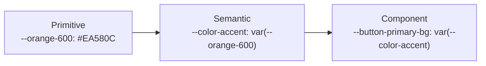

# 02 · Tokens

Tokens are named design decisions. The system uses a **three-tier chain**; each tier may only reference the tier above it.



| Tier | Describes | Example | Who uses it |
|---|---|---|---|
| **Primitive** | *What it is* — raw palette & scales | `--orange-600`, `--space-4`, `--radius-2` | Only semantic tokens |
| **Semantic** | *What it's for* — role/intent | `--color-bg-surface`, `--color-text-muted`, `--color-accent` | Components, sections |
| **Component** | *Where it's used* — scoped overrides | `--button-primary-bg`, `--card-padding` | One component |

Rule: **components never reference primitives directly.** That is what makes theming (dark mode, a second brand) a token swap instead of a refactor.

## Naming

```
--{category}-{role}-{variant}-{state}
--color-text-primary
--color-bg-surface-raised
--color-border-focus
--button-primary-bg-hover
```

- Categories: `color`, `space`, `radius`, `shadow`, `font`, `text` (size), `leading`, `duration`, `ease`, `z`.
- Roles describe intent (`surface`, `muted`, `danger`), never appearance (`light-gray`, `big`).
- Scales are numeric and monotonic: `--space-1 … --space-12`, `--shadow-sm | md | lg`.

## Scales (suggested)

| Scale | Values |
|---|---|
| Spacing (4 px base) | 0, 4, 8, 12, 16, 20, 24, 32, 40, 48, 64, 80, 96 |
| Radius | 0, 4, 8, 12, 16, full |
| Shadow | sm, md, lg, xl — nothing else |
| Type | 12, 14, 16, 18, 20, 24, 30, 36, 48, 60 (fluid with `clamp()` for display sizes) |
| Motion | 120 ms (micro), 200 ms (standard), 320 ms (emphasis) |

## Light / dark

Themes swap **semantic** tokens only. Primitives are theme-agnostic; components never change.

```css
:root {
  --color-bg-canvas: var(--neutral-50);
  --color-text-primary: var(--neutral-900);
}
.dark {
  --color-bg-canvas: var(--neutral-950);
  --color-text-primary: var(--neutral-50);
}
```

Every semantic color must pass its contrast requirement **in both themes**. Check them as pairs (text token × background token), not individually.

## The `-text` pattern

Brand accents are usually chosen for how they look as *fills* — and they very often fail AA as *text* on light backgrounds. Don't darken the brand. Add a dedicated, darker text token.

### Worked example (generic orange accent)

Brand accent: `--orange-500 #F97316`. Background: white `#FFFFFF`.

| Usage | Pair | Ratio | AA (4.5:1 text / 3:1 large & UI) |
|---|---|---|---|
| Accent as link text | `#F97316` on `#FFFFFF` | **2.80:1** | Fails |
| Accent as link text on off-white | `#F97316` on `#FAFAF9` | 2.68:1 | Fails |
| `-600` as text | `#EA580C` on `#FFFFFF` | 3.56:1 | Large text / UI only |
| **`-700` as text** | `#C2410C` on `#FFFFFF` | **5.18:1** | Passes |
| `-700` on off-white | `#C2410C` on `#FAFAF9` | 4.96:1 | Passes |
| White label on `-700` button | `#FFFFFF` on `#C2410C` | 5.18:1 | Passes |
| Dark theme: `-400` text on near-black | `#FB923C` on `#0A0A0A` | 8.75:1 | Passes |

So the system ships:

```css
--color-accent:      var(--orange-500); /* fills, illustrations, decorative only */
--color-accent-text: var(--orange-700); /* accent-colored TEXT on light surfaces — 5.18:1 */
.dark { --color-accent-text: var(--orange-400); } /* 8.75:1 on near-black */
```

Rules:
1. Any accent used as text gets a `-text` token verified at ≥ 4.5:1 against every surface it can appear on.
2. Filled buttons with white labels are checked separately — the fill must be dark enough for the label (here `-500` fails at 2.80:1, so the button uses `-700`, or a dark label).
3. Contrast is measured against the **worst** background the text can sit on: images, gradients, and the worst frame of an animated background count.

## Tailwind v4 mapping

Expose semantic tokens through `@theme` so utilities are generated from them (`bg-surface`, `text-accent-text`). See [`templates/tokens.css`](../templates/tokens.css).
