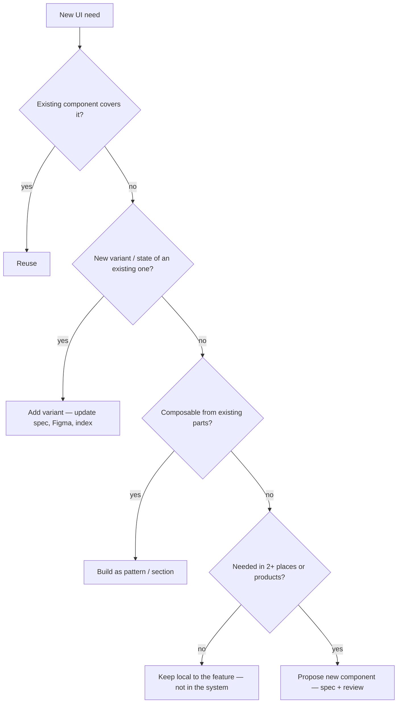

# 08 · Governance

A system without governance becomes a junk drawer. The core question for every addition:

## "Does this belong in the system?"

Promote a local one-off into the system only when it's used **twice**. Until then it lives with the feature.

## Proposal requirements (new component or token)

- Problem and where it appears (≥ 2 uses)
- Why the reuse ladder didn't cover it
- Spec from [`templates/component-spec.md`](../templates/component-spec.md)
- Token impact (new tokens? renamed ones?)
- A11y notes

## Roles

| Role | Owns |
|---|---|
| System owner | Tokens, design.md, approval of new components |
| Documenter | Components index, docs, Figma doc pages — keeps docs true |
| Contributors (humans or agents) | Build within the rules, log debt, never bypass gates |

## Versioning

Semantic versioning for the system:

- **Major** — renamed/removed tokens or props, breaking visual changes
- **Minor** — new components, variants or tokens
- **Patch** — bug fixes, value tweaks within a token's intent

Deprecate before removing: mark `@deprecated` with the replacement, keep for one minor version, then remove in the next major.

## Changelog discipline

Every significant change gets a dated line in `design.md` → Changelog. Deferred work is logged too — "deferred" is fine, "forgotten" is not.
